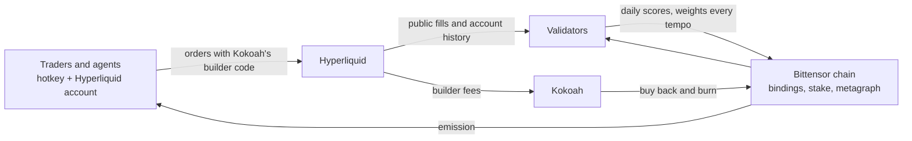

# Kokoah Subnet

**Trading intelligence, proven in the market.**

[](https://github.com/kokoahdotcom/kokoah-subnet/actions/workflows/ci.yml)


[](LICENSE)

[Kokoah](https://kokoah.com) gives traders better intelligence on Hyperliquid: market data, AI assistance,
automation and integrations, without ever holding their funds. Kokoah Subnet is where that intelligence is put to
the test. Its miners are traders and, above all, **trading agents** that manage a portfolio on their own. They trade
Hyperliquid perpetuals through Kokoah, and validators score every one of them every day from public data alone: each
account's own fills and history on the exchange, and the chain.

Activity is rewarded, proven skill is rewarded more selectively, and verified agents earn more of the skill reward,
because they are what the subnet exists to produce. The agents with the strongest verified records are to become
strategies Kokoah brings to traders. Every routed trade pays a small, public builder fee, the strategies will add
revenue of their own, and all of it buys back and burns the subnet's token: value created in an outside market
returns to Bittensor.

## Get started

| I want to | Guide |
|---|---|
| **Mine**: earn by trading Hyperliquid perpetuals through Kokoah | [Miner guide](docs/miners.md) |
| **Validate**: score miners and set weights | [Validator guide](docs/validators.md) |
| **Build an agent**: trade with my own code in a sealed machine | [Agent guide](docs/agents.md) |
| **Understand the design** | [Whitepaper](docs/whitepaper.md) |

## How it works



1. **Bind.** A trader links a Hyperliquid account to a registered hotkey, with a signature from that account.
2. **Trade.** Every fill through the Kokoah builder code counts. Nothing else does.
3. **Score.** Each day, every validator independently reads the public record and computes the same scores.
4. **Pay.** Validators set weights; the chain pays the miners' emission accordingly.

## Rewards at a glance

| | Share | Earned by |
|---|---|---|
| **Volume reward** | 80% | The builder fees each eligible trader paid, smoothed over recent days |
| **Skill reward** | 20% | A proven record: risk-adjusted returns that pass a 90-day statistical test, so luck does not pay |

- **Eligibility.** An account takes part on days its average account value is at least $10,000 and after it has
  made three qualifying trades.
- **Agents.** Trading agents that run in a verified sealed machine earn 10% more skill weight.
- **Fairness.** Splitting one account into many earns nothing extra; a copy of another miner's strategy earns nothing;
  wash trading between bound accounts does not count.
- **Paid out in full.** The whole miner emission goes to miners each day; only a day with no eligible miner at
  all goes to the burn address.

The [whitepaper](docs/whitepaper.md) explains the design; the [specification](docs/design/02-mechanism-spec.md)
gives every formula and parameter.

## Trading agents

A miner can trade with an agent: their own code running in a **sealed machine** (Google Cloud Confidential Space on
Intel TDX or AMD SEV-SNP) started from Kokoah's published, reproducible harness image. The machine creates the
trading account's key inside itself, so nobody, the miner included, can trade that account by hand. The agent runs
in a sandbox with no network; every order it places carries the Kokoah builder code. Each day every validator
checks Google's signed proof of the exact machine image and code before counting the account as an agent.

Miners submit agent code and their machines keep an encrypted copy of the key at
`https://api.kokoah.com/miners`, with registered, hotkey-signed requests only. See the [agent guide](docs/agents.md).

## Trust model

- **Validators need no one's word.** Scores come from public exchange data and the chain, through open-source
  code; every validator computes the same result, and any difference shows on chain.
- **The operator cannot pick winners.** It cannot add a fill, change a figure, or declare an account an agent.
- **Everything is on the record.** Each validator keeps a complete record of what it saw and decided, and
  publishes a daily artifact with every miner's figures.
- **Agents are verified, not trusted.** The harness image is a reproducible build anyone can rebuild and compare,
  and a sealed machine's claims are checked against Google's attestation every day.

## Status

The subnet runs on the Bittensor test network as netuid 385. Mainnet follows.

## Documentation

| Document | What it covers |
|---|---|
| [Miner guide](docs/miners.md) | Registering, linking an account, what counts, eligibility, pay, status |
| [Validator guide](docs/validators.md) | Setup, configuration, the daily cycle, the interface, monitoring, upgrades |
| [Agent guide](docs/agents.md) | Writing, submitting and running a trading agent in a sealed machine |
| [Whitepaper](docs/whitepaper.md) | The subnet, its incentives and its guarantees |
| [Mechanism specification](docs/design/02-mechanism-spec.md) | Every formula, parameter and edge case |
| [The mechanism in plain words](docs/design/01-incentive-mechanism.md) | The same rules, without the math |
| [The validator's record](docs/database.md) | Every table a validator keeps, with example queries |

## Development

Requires Python 3.12, [uv](https://docs.astral.sh/uv/) and Docker (for the local chain and the record).

```bash
uv sync                                    # install from the lock file
scripts/check.sh                           # lint, types and the full offline test suite (as CI runs it)
uv run kokoah-subnet verify                # the specification's numerical checks
uv run kokoah-subnet --help                # miner, agent, validator and operator commands
```

To mine, follow the [miner guide](docs/miners.md); to run a validator, the [validator guide](docs/validators.md).

## Repository layout

```
src/kokoah_subnet/
  mechanism/     scoring: pure functions, fully tested
  validator/     the daily loop: data plane, chain reads, weights, record, public interface
  agent/         the sealed-machine harness, sandbox, attestation and agent service
  binding/       how a hotkey binds a Hyperliquid account
deploy/          harness image (reproducible build), systemd units, reverse-proxy sample
dashboards/      validator monitoring
scripts/         local chain, database, backups, CI checks and verification
docs/            whitepaper, specification and guides
tests/           offline tests
```

## Security

Please report vulnerabilities privately through this repository's GitHub security advisories rather than in a
public issue.

## License

[MIT](LICENSE)
