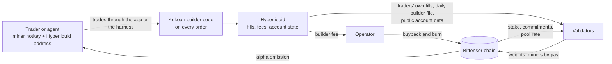
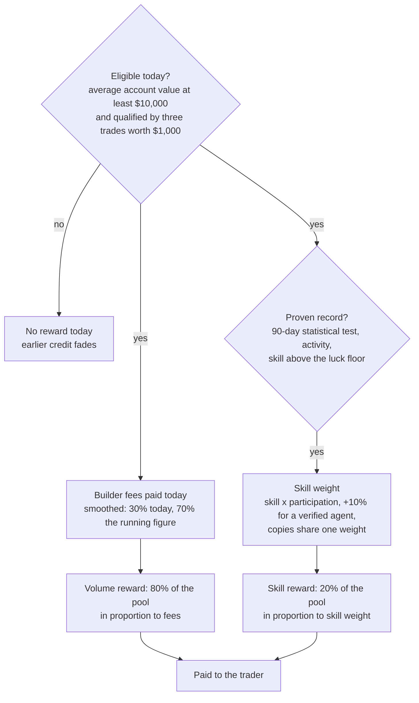

# Kokoah Subnet

## Verified trading activity as a Bittensor subnet

Whitepaper, version 2.0, October 2026. Mechanism specification v6.0.

### Summary

Kokoah Subnet brings real trading to Bittensor. Its miners are traders on Hyperliquid, one of the most active
perpetual-futures venues, who route their trades through the Kokoah application, by hand or with an automated
agent. Every routed trade pays a small builder fee to the operator, and those fees buy back and burn the subnet
token on chain, so revenue earned outside Bittensor flows back into it. Validators score each trader from the
exchange's own public records and from chain state, so the work the subnet rewards is real, external and checkable
by anyone. The whole daily miner emission goes to traders in two parts: four fifths in proportion to the builder
fees each trader paid, and one fifth to traders who prove a real trading record over three months. Agents that run
in sealed cloud machines, verified by the validators themselves, earn a little more of the skill reward.

### Key facts

- **Miners are traders.** They register a hotkey, bind their Hyperliquid address with one signed line, and trade.
  A trader who prefers automation runs an agent in a sealed machine instead.
- **Scored from public data.** Validators recompute everything from each trader's own fills on the exchange,
  cross-checked with the exchange's per-builder daily file, from each trader's public account history and from the
  chain; every validator reaches the same weights from the same inputs, and the fees credited to traders are
  checked against what the exchange reports the builder has earned.
- **80% for activity.** The volume reward is shared in proportion to the builder fees each trader paid. Twice the
  fees, twice the reward; splitting an account in two changes nothing.
- **20% for proven skill.** The skill reward goes only to traders whose daily returns pass a strict statistical
  test over 90 days, so luck, copied strategies and split accounts cannot take it.
- **Verified agents earn 10% more skill weight.** An agent runs in a sealed cloud machine that creates the trading
  account's key inside itself and never lets it out, so no person can trade that account by hand. Every validator
  checks the machine's signed proof on its own.
- **Real traders with real capital.** A trader earns on a day when the account's average value that day is at
  least $10,000, after three first trades worth $1,000 together.
- **The whole emission is paid out.** Nothing is held back or destroyed in normal operation.
- **Revenue returns to the network.** The builder fees buy back and burn the subnet token, each buyback one
  on-chain transaction.
- **Everything is on the record.** Every validator keeps a complete, queryable record of every fill, every figure
  and every decision, and serves the ranking and the daily artifacts over a read-only interface.

---

## 1. What the subnet brings to Bittensor

Bittensor's premise is that token emission should flow to measurable, useful work. Subnets that measure their
work against an external, independent source of truth are the easiest for the network to trust, and subnets that
bring revenue and participants from outside the network make the whole network stronger. Kokoah Subnet is built
to do both.

- **Revenue from outside the network.** Every routed trade pays a builder fee that the exchange itself charges and
  publishes. Those fees buy back and burn the subnet token on chain, transaction by transaction. Value earned on an
  external venue is returned to the network in a form anyone can verify.
- **New participants and capital.** Hyperliquid traders join Bittensor to take part: they register hotkeys, lock
  collateral and keep at least $10,000 at work in their trading accounts. A trading community that had no reason to
  be on Bittensor gets one.
- **A verifiable data product.** The public ranking of traders, computed by independent validators from the
  traders' own fills, is a signal that did not exist before: who trades well, at what scale, with what
  consistency, with no self-reporting anywhere.
- **Verifiable automated trading.** Kokoah adds AI assistance to its platform so that trading is easier for
  everyone, and the subnet already measures trading by agents: code running in sealed machines whose identity
  anyone can check, beside the human traders, on the same public data.

Trading on a public exchange is a good source of truth. Every fill on Hyperliquid is a public record with a price,
a size, a side, a fee and a counterparty; account values and deposits are public; and the venue's builder code
attributes each order to the application that routed it and charges a fee the venue publishes. A subnet built on
this data pays for an activity that is real, priced by an outside market and revenue-generating, without asking the
network to trust the operator's measurements.

## 2. How it works



Figure 1. The flow. Trades carry the builder code to the exchange; the exchange's fee funds the buyback; the
exchange's public data and the chain feed the validators; the validators' weights pay the traders.

Once a day, after the UTC day closes, every validator reads which hotkey each address is bound to, reads each bound
address's own fills from the exchange together with the exchange's daily file of fills routed under the Kokoah
builder code, confirms each fill's order carried the Kokoah builder code, works out from the exchange's recorded
account values whether each trader held at least $10,000 on average through the day, challenges every agent's
sealed machine, reads stake and the pool rate from the chain, and scores the day. The weights it sets every tempo
pay each trader their share. Everything it fetched and decided goes into its record and its daily artifact.



Figure 2. The pay rule. Eligible traders share the volume reward by the fees they paid; traders with a proven record
also share the skill reward.

## 3. Who does what

**Traders.** Register a hotkey on the subnet, sign one line with the Hyperliquid wallet (appendix D) and publish it
as the hotkey's commitment, then trade perpetuals through the Kokoah application. That is all. No software to run,
no keys to share, no reporting. Pay arrives as alpha on the hotkey every tempo. To earn, a trader keeps an account
averaging at least $10,000 over the day and, once at the start, completes three trades worth $1,000 together; there
is no waiting period. The exchange's own account history counts toward the skill record from the first day. A
trader can move to a new address once per 60 days and keep their track record, pay history and skill; the fee
credit and the qualification start again with the new address, as they do after a hotkey swap or a new registration.

**Agent builders.** Write a trading agent (a small program with an `entry.py`), package it, optionally encrypted,
and submit it to the operator's agent service, signed by the hotkey. Start Kokoah's published harness image in a
sealed machine on their own cloud account; the machine fetches exactly that submission, creates the account's key
inside itself, and signs the binding line with it. Fund the account, publish the binding with the machine's
address, and the agent trades. The agent's code never leaves the machine in readable form if it was encrypted, and
nobody, the builder included, can trade the account by hand (section 6).

**Validators.** Run the open-source validator with a hotkey and a database. It fetches public data, challenges the
agents' machines, scores the day, sets weights every tempo, keeps the record and serves the daily artifacts and the
leaderboard over a read-only interface. Any number of validators can run; they agree because the computation is
deterministic over public inputs.

**The network.** Receives revenue it did not have, through buybacks that anyone can check on chain; gains
registered, staked participants from a community outside Bittensor; and gets a verifiable ranking of traders and
agents as a data product.

**The operator (Kokoah).** Runs the application and the agent service, publishes the harness image, collects the
builder fee the exchange charges, commits each day's file hash on chain so validators can check theirs, runs the
buyback, and publishes the code, the parameters and every change. What the operator cannot do is in section 8.

## 4. The pay rule

Every number below is a parameter of specification v6.0; the complete formulas are in appendix A.

**Eligibility.** A trader earns on a day when two things hold. The account's average value over that day is at
least $10,000, measured from the exchange's own recorded history of the account through the whole day, not from a
balance at one moment. And the trader has qualified: a new identity's first three trades, worth $1,000 together,
qualify it; the trade that completes both earns credit, the two before it do not. On a day that falls short, the
trader's activity, account value and skill are recorded as usual, but the day's trades earn no credit, the earlier
credit fades as it would on a quiet day, and nothing is owed later. There is no permanent exclusion: the first day
back at $10,000 earns again.

**Fee credit.** A trader's credit for the day is the builder fee paid on their fills, 0.025% of notional on every
order, maker and taker alike. The credit is smoothed: 30% of today's fees count today, 21% tomorrow, 15% the day
after, and so on. The weights sum to one, so every dollar of fees is counted exactly once; smoothing only spreads
it, which keeps a burst of activity from moving the ranking for a single day.

**The volume reward.** Four fifths of the day's miner emission is shared among eligible traders in proportion to
their smoothed fee credit. Because the share is linear in fees paid, splitting one account into many or merging
many into one changes nothing.

**The skill reward.** One fifth is shared among traders with a proven record. Three things decide who takes part
and with what weight:

- **The entry test.** The trader's daily returns over the last 90 days, computed from account value with deposits,
  withdrawals and vault transfers removed and any money moved in through off-market fills removed as well, each day
  capped at ±10%, must pass a probabilistic Sharpe ratio test at 95% confidence against a modest benchmark. In
  simulation, accounts with no edge pass about 3% of the time and lottery-style accounts almost never; a strong
  trader passes about half the time over 90 days. Proving a real edge takes months, which is what keeps luck out.
- **The skill score.** Is the edge statistically real (the probabilistic Sharpe ratio of the last 60 days), and are
  recent gains clearly larger than recent losses (a recency-weighted gain-to-pain ratio of the last 30 days, halved
  if two or more days in the last 60 lost more than 10%)? The two are multiplied, smoothed like the credit, and
  scaled so that a strong trader scores 1. Only the part above a luck floor of 0.25 counts.
- **Participation.** The skill weight grows with the trader's eligible Kokoah volume over the last 30 days, up to
  $1 million; beyond that, more volume adds nothing to the skill reward.

The skill weight is the skill above the floor times participation, with 10% more for a verified agent. Accounts
whose daily returns move almost exactly together over 30 days or more share a single weight, so the same strategy
in ten accounts earns what it would in one, and splitting a large account into several gains nothing. The skill
reward also needs the activity gates (10 round trips, 7 active days and a mean account value of $500 over the last
30 days) and no active mirror report. On a day nobody qualifies for it, the skill reward joins the volume reward.

**What never counts.** Spot fills: the subnet scores perpetuals only in this version. Fills against the trader's own
cluster (sub-accounts, addresses on the same coldkey, addresses funded by or transferring with each other); fills
against another bound address, since the subnet does not pay for volume between its own miners (both sides of
every trade carry the same trade id, so this is exact); fills priced more than 0.5% from the exchange's minute mark,
which are valued at the mark; and fills whose order did not carry the Kokoah builder code, which the validator
confirms from the trader's own signed orders. Persistent hedging through the market is caught by position: daily net
positions correlated below −0.8 with another bound address on at least 10 days in the last 30. Mirrored volume above
25% of an address's notional is removed from its credit; above 50%, both addresses are reported and leave the skill
reward for 30 days.

**Parameters.** Builder fee 0.025%; smoothing 0.3 a day; pools 80% volume and 20% skill; entry test 95% over 90
days; luck floor 0.25; participation full at $1M over 30 days; copy rule above 0.9 correlation over 30 days; agent
bonus 10% of the skill weight; gates 10 round trips, 7 days, $500; eligibility $10,000 average account value a day
and three qualifying trades worth $1,000; mirror thresholds 25% and 50%; migration once per 60 days; emission split
miner 41%, owner 18% (locked), validators 41%. Changes follow section 8.

## 5. Two rewards, two kinds of contribution

The two rewards pay for two different things, and each is protected against what would otherwise exploit it.

**The volume reward is a fee rebate traders compete for.** A trader's income from it, per dollar of builder fee,
is large while few fees are paid and falls as more are. Anyone who trades mainly to earn it, rather than for the
trade itself, joins only while the reward per fee dollar exceeds what the trading costs them, so in equilibrium the
volume reward is worth about what such traders pay in fees, and the builder-fee part of what they pay is the
operator's revenue, which funds the buyback. Splitting and merging accounts change nothing, because the reward is
linear in fees.

| Traders paying $500 of builder fees a day each, reward worth $12,667 a day | 1 | 5 | 20 | 100 |
|---|---|---|---|---|
| volume reward per trader per day | $3,378 | $1,448 | $461 | $99 |
| what that trading costs a base-tier taker | $1,400 | $1,400 | $1,400 | $1,400 |

**The skill reward pays only for a proven edge.** Trading that exists only to generate volume has no edge, and an
account with no edge almost never passes the 90-day test; in simulation such accounts take under a twentieth of a
strong trader's weight on average. Copies of one strategy share one weight; splitting a large account gains nothing;
a fresh identity has to pass the test again from its own record.

**What the protections do not need.** No rule asks a trader why they trade. A market maker earns the volume reward
on every fill like everyone else; a swing trader with a real edge earns both; an agent earns both and the agent
bonus. What a trader cannot do is buy the skill reward with volume, take it with luck, or multiply it with copies.

## 6. Trading agents

An agent is code that trades an account with no person able to trade it. Kokoah publishes the **harness**, a small,
auditable program that runs in a **sealed machine**: a Google Cloud Confidential Space virtual machine on Intel TDX
or AMD SEV-SNP hardware, whose memory the cloud host cannot read and whose software Google attests in a signed token.

- **The account's key is born inside the machine.** The harness creates the Hyperliquid account's key inside the
  machine and never exports it. The exchange accepts only orders signed with that key, so nobody, the agent's author
  included, can trade the account by hand. A copy encrypted with a secret only the agent's owner holds is kept by
  the operator's service, which cannot read it. If the machine stops, a new sealed machine started with the same
  secret proves it is genuine and gets the copy back, so the account carries on as an agent. The owner can also
  take the key out themselves with a request signed by their own wallet; that is recorded publicly, and the account
  never earns the agent bonus again, since a person now holds its key.
- **The agent runs in a sandbox.** The submitted code runs as a separate user, with no network at all: every
  attempt to open an internet connection is refused by the operating system. Its only way out is a local channel to
  the harness, which offers orders, cancels and leverage changes, and read-only market and account data.
- **Every order carries the Kokoah builder code.** The harness attaches it, marks the order as an agent's, and
  refuses prices far from the market. It offers no withdrawals, transfers or approvals; withdrawals go only to the
  owner's own address, on a request signed by it.
- **Private code stays private.** An agent can be submitted encrypted with a key only its author holds; it is
  decrypted only inside the sealed machine. Its fingerprint, which reveals nothing about its content, is what the
  author commits on chain.

**How validators verify an agent, every day, on their own.** The validator sends the machine a fresh random
challenge. The machine answers with a token from Google that names the exact harness image, shows the machine is a
production confidential machine, and carries both the challenge and a digest of the subnet, the hotkey, the account
and the code fingerprint. The validator checks Google's signature, that the image is an approved harness, that the
fingerprint is the one committed on chain, and on the exchange that the account has no other trading key approved.
It also checks that the account's key was never released to its owner. Only then does the account count as an
agent that day. The check trusts neither the agent's author nor the operator's word about the machine; the one thing
it takes from the operator is the public list of released keys.

## 7. Sustainability

**Revenue.** Every routed trade pays the builder fee, from bound traders and other Kokoah users alike. The operator
spends the collected fees on buying back and burning the subnet token on a published cadence, each time as one
`add_stake_burn` transaction that buys alpha with TAO and burns it in a single call. A coverage figure, cumulative
buyback over cumulative alpha received by miners, is published for information.

**The volume reward pays for itself in revenue.** Section 5 shows why: traders who trade for the reward join until it
is worth about what they pay in fees, so the reward and the revenue it brings grow together.

**The owner's share.** The owner's 18% of emission is locked by enabling the chain's `owner_cut_auto_lock_enabled`
hyperparameter, so the operator never sells into its own buyback.

**The record of every credited fee.** The exchange reports what the operator's builder has earned. Every validator
compares the builder fees it credits to traders with that figure and raises an alarm if the credited fees are ever
larger: every fee the subnet pays for must have reached the builder.

## 8. What the operator cannot do

The weights that pay traders are set by validators, not by the operator. Validators run the open-source code on
public inputs: each trader's own fills and account history on the exchange, the exchange's per-builder file, the
agents' attestation tokens signed by Google, and chain state. The operator's only input to scoring is the hash of
the day's file, committed on chain from the owner hotkey, which validators compare with the hash of the file they
fetched themselves; a mismatch is published. The operator cannot add a fill, change a figure, pay a favorite,
withhold a payment or declare an account an agent: any validator would compute a different result and the chain's
consensus would show it. The agent service only stores submissions; validators compare the
fingerprint the attested harness reports with the one committed on chain, not with anything the service says.

Parameters are part of the versioned code. A change is announced at least seven days before it takes effect,
recorded in the changelog (appendix F), and published in every daily artifact as the mechanism's version number.
Validators adopt it by updating; nothing changes until they do. A new harness image counts only once its digest is
added to the approved list in the validator code.

Every validator keeps a complete relational record of what it saw and decided: every builder fill, from the
trader's own history or the builder file, with its source, whether it counted and why not; every per-miner figure
with the parts behind it (eligibility, smoothed credit, skill and its parts, the entry test, the skill weight, the
copy groups, both rewards); every account value with the recorded points behind each day's average; every agent
check with its result; every ledger entry, position, commitment and binding decision; every pool and stake sample;
every epoch's payout per UID as the chain made it; every weight submission and every error. The ranking and the
artifacts are served over a read-only interface (appendix E) by every validator.

## 9. Growth

The subnet's growth is measured in things anyone can count on chain or at the exchange, and never in the subnet
token's market.

**Stage one: the first traders.** A handful of Hyperliquid traders bind their addresses through the Kokoah
application, and the first agents run in sealed machines. Volume through the builder code is small and the volume
reward is generous per fee dollar, which draws activity. What matters at this stage is that every number is
produced and published as designed: fills counted, ranks computed, agents verified, weights set, the record
complete.

**Stage two: a venue's worth of traders.** The application's assistance features bring traders who would not have
used a Bittensor subnet on their own. Volume through the builder code grows into the tens of millions of dollars a
day, the volume reward settles into a competitive fee rebate, and the first traders and agents complete 90-day
records and share the skill reward. Buybacks become regular, each one a public transaction.

**Stage three: a reference for verified trading.** The ranking becomes a reference: a trader's or an agent's place
in it is earned from their own fills, verified by independent validators, and the skill reward goes to records that
held up for months. Revenue from outside the network returns to it on a regular cadence, and a trading community of
people and agents is a registered, staked part of Bittensor.

Every stage is read from the same record: traders and agents bound, volume routed, fees collected, alpha paid,
buybacks executed.

## 10. Verification

**Done.** The whole pool is paid on 2,000 random days; the volume reward is unchanged by splitting one account into
2, 5 or 20; the entry test's pass rates on simulated records (no edge 3%, lottery 0%, a modest edge 17%, a strong
edge 51%) and the mean skill weight per account (luck under a twentieth of a strong trader's); ten copies of one
strategy earn one weight; the agent bonus is exactly 10% of the skill weight and nothing else; a 150-day replay in
which strategies without an edge took none of the skill reward. The data plane recovers every builder fee the
exchange credits to the operator's builder, to the cent, with every row of the daily file matched and every
history-only fill confirmed from the trader's own signed orders. The sealed-machine path end to end: submission,
key creation, its encrypted copy, restore on a new machine and public release, the sandbox (no network, no access to other processes), orders through the harness with
the builder code, and every validator check with each failure case; the harness image built and run with an
example agent reading live market data through the harness. Two independent validators on the test network scored
the same days with identical weights.

**Before mainnet.**

1. An agent on a real Confidential Space machine: a Google-signed token from the released image verified by the
   validator, and the cloud key service's condition on the image.
2. An agent trading the exchange's test network through the harness: orders, cancels, leverage and a withdrawal.
3. A month of real traders and agents on the test network: who passes the entry test, the copy groups, the volume
   competition.

**Assumptions.** Each trader's own fill history is complete and names every builder fee but not the builder; the
validator confirms the builder from the trader's own signed orders. The exchange keeps day-by-day account values for
about a month, so the rest of a 90-day record is the subnet's own daily record. Google's attestation and the
confidential hardware are trusted for the agents' isolation; memory-bus attacks need physical access, which a cloud
machine denies its user. Whether, and when, root enables emission for a new subnet is the network's decision.
Paying tokens for trading activity is subject to legal review in the operator's jurisdictions.

## 11. Roadmap

Done: the scoring library with its tests, the validator with its record and interface, the binding flow, the data
plane from the traders' own histories, eligibility, the two rewards, the sealed-machine agent harness with its
sandbox, key handling, agent service and validator checks, and a test-network subnet with running validators.

Next: the released harness image on a real sealed machine and its digest approved; real traders and agents on the
test network for at least a month; then mainnet, only after the verification list is complete and published, with
the parameters the test-network period supports.

Beyond the subnet itself, Kokoah's platform keeps adding AI assistance so that trading is easier for everyone: help
with reading the market, with sizing and managing positions, and with learning from one's own record, the same
record the subnet verifies. Agents built with that assistance, and agents written by anyone, can run in sealed
machines and be measured by the same mechanism on the same public data.

## 12. References

- Bailey, D. H., and M. López de Prado (2012). The Sharpe ratio efficient frontier. Journal of Risk 15(2).
- Chen, Y., C. Papadimitriou, and T. Roughgarden (2019). An axiomatic approach to block rewards. arXiv:1909.10645.
- Cong, L. W., X. Li, K. Tang, and Y. Yang (2023). Crypto wash trading. Management Science; NBER w30783.
- Victor, F., and A. M. Weintraud (2021). Detecting and quantifying wash trading on decentralized cryptocurrency
  exchanges. arXiv:2102.07001.
- Hyperliquid documentation: fees, builder codes, info endpoint, API wallets.
  https://hyperliquid.gitbook.io/hyperliquid-docs/trading/fees ·
  https://hyperliquid.gitbook.io/hyperliquid-docs/trading/builder-codes ·
  https://hyperliquid.gitbook.io/hyperliquid-docs/for-developers/api/info-endpoint
- Google Cloud Confidential Space: attestation token claims.
  https://cloud.google.com/confidential-computing/confidential-space/docs
- Bittensor (Rao Foundation) subtensor: emissions, emission weights, `run_coinbase.rs`, `subnet_emissions.rs`.
  https://github.com/RaoFoundation/subtensor

---

### Appendix A. The formulas

Notation: `i` a miner, `d` a scoring day (00:00 UTC), `f` a fill of miner `i` whose order carried the builder code,
`n_f` its notional in USD, `b_f` the builder fee it paid (0.025% of notional, maker or taker). `A_d` is the day's
miner emission (41% of 7,200 alpha, 2,952 alpha).

Eligibility, each day: `Ē_i,d = (1/24 h) × ∫ E_i(t) dt` over the day, from the exchange's recorded account values
joined by straight lines (at least 4 recorded points in the day; otherwise unknown, and unknown is not eligible),
and qualification: the first 3 trades with at least $1,000 of eligible notional together, the first two uncredited.
A miner with `Ē_i,d < $10,000` or not yet qualified has `Φ_i,d = 0` and takes no part in either pool.

```
Φ_i,d     = Σ_f b_f                                       fee credit of the day (eligible trades only)
Φ̂_i,d     = 0.7 × Φ̂_i,d−1 + 0.3 × Φ_i,d                    smoothed credit
S_d       = 0.20 × A_d   if any skill weight, else 0       skill pool
V_d       = A_d − S_d                                     volume pool
pay_i,d   = V_d × Φ̂_i,d / Σ_j Φ̂_j,d  +  S_d × w_i,d / Σ_j w_j,d
```

Skill, from daily returns `r_d = (E_d − E_d−1 − flows_d − offmarket_d) / E_d−1` capped to
`r̃_d = clip(r_d, −0.10, +0.10)`:

```
confidence = clip((PSR_60 − 0.5) / 0.45, 0, 1)      PSR: probabilistic Sharpe ratio, skew- and kurtosis-adjusted,
                                                     against a daily Sharpe of 0.03; 0.5 with fewer than 10 days
quality    = clip((GPR_30 − 1) / 1.2, 0, 1)          GPR: gain-to-pain with weights 0.5^(age / 10 days);
                                                     halved if 2+ days < −10% in the last 60
g_d        = 0.7 × g_d−1 + 0.3 × confidence × quality
g'_d       = min(1, g_d / 0.65)
```

The skill pool:

```
entry      = PSR of the last 90 days of r̃ ≥ 0.95, gates passed, no mirror report, eligible today
s_i        = max(0, (g'_i − 0.25) / 0.75)
v_i        = min(1, credited Kokoah notional over 30 days / $1,000,000)
w_i        = s_i × v_i × (1.1 for a verified agent)       when entry holds, else 0
copies     = accounts with daily-return correlation > 0.9 over ≥ 30 common days share max(w) between them
```

The agent check, by each validator:

```
binding    = sha256("kokoah-agent-1 netuid=<n> hotkey=<ss58> address=<0x..> code=<sha256 of the code zip>")
agent      = Google's signature on the token ∧ production Confidential Space machine on confidential hardware
             ∧ approved harness image ∧ the token's nonces include the validator's challenge and the binding
             ∧ the machine's answer names the committed code fingerprint ∧ no other trading key on the account
```

### Appendix B. Worked example

Three eligible traders on one day, with equal smoothed builder fees. Trader A has passed the 90-day test with a skill
weight of 0.8; trader B trades through a verified agent and has also passed, with skill above the floor and
participation giving 0.8 before the bonus, so 0.88 after it; trader C has no proven record yet. The volume reward
(2,361.6 alpha) splits three ways, 787.2 alpha each. The skill reward (590.4 alpha) splits between A and B in the
ratio 0.8 to 0.88: 281.1 and 309.3 alpha. A is paid 1,068.3 alpha, B 1,096.5 and C 787.2; the whole pool is paid.

If A ran the same strategy in a second account, the two accounts' weights would sum to 0.8 together, and the total
paid to A's strategy would not change.

### Appendix C. A validator's day

1. Fetch the previous UTC day's per-builder fill file (waiting up to twelve hours after the day for it); verify its
   hash against the operator's on-chain commitment.
2. Read every commitment on the subnet; resolve which address each hotkey is bound to, and which bindings are agents.
3. Challenge every agent's sealed machine and verify its token, its code fingerprint and the account's trading keys.
4. For each bound address: fetch its own fills, merge them with the daily file, confirm each history-only fill's
   order carried the builder code from the address's own signed orders, name counterparties by trade id against
   the other bound addresses and the linked accounts; check off-market fills against the exchange's minute candles;
   read account value and ledger for returns and flows, positions, the fee schedule, sub-accounts and transfer
   partners for clusters; read the account's recorded value history for the day's average; read the day's stake and
   the pool rate from the chain at blocks anchored to the day. A failed read of the fill history, the explorer or
   the value history delays the day's scoring instead of costing a trader a fill or eligibility.
5. Compute eligibility and qualification, the smoothed credit, the skill score, the entry test, the skill weights
   with the copy rule and the agent bonus, and both rewards.
6. Write everything to the record; publish the per-miner artifact; set weights (miners by pay) every tempo until the
   next run.

### Appendix D. Binding format

The Hyperliquid address signs, as an Ethereum personal message (EIP-191), exactly this line:

```
kokoah-bind-1 netuid=<netuid> hotkey=<hotkey ss58> address=<0x address, lowercase>
```

The hotkey publishes the result as its commitment on the subnet: one raw field of 116 characters, the base64 of
`"K1"` + the 20-byte address + the 65-byte signature. A migration adds a field `"P1"` + the previous address + its
signature over the same line. An agent account adds a field `"A1"` + the 32-byte code fingerprint + the machine's
port (2 bytes) + its host (up to 51 bytes); for an agent, the binding line is signed by the key inside the sealed
machine. Validators recover the signer from each signature and accept the binding only when it is the named
address. The chain keeps only a hotkey's latest commitment, so each validator enforces the 60-day migration limit
from the bindings it has itself accepted.

### Appendix E. Validator interface

Read-only, served by every validator: `/days` (scored days), `/days/latest` and `/days/{day}` (the full daily
artifact: per-miner eligibility, credit, skill and its parts, the entry test, the skill weight, both rewards, agent
status; weights; file hash and whether it matches the operator's commitment; refused bindings; errors), `/bindings`,
`/leaderboard` (the ranking with totals over all days), `/summary` (alpha paid, builder fees, totals over all days),
and `/` (the leaderboard page).

### Appendix F. Changelog

- **2.0 (2026-10-22).** Mechanism v6.0. The whole miner emission is paid out in two rewards: 80% by builder fees
  paid, 20% by proven skill (a 90-day entry test at 95% confidence, a luck floor, participation capped at $1M of
  volume over 30 days, and a copy rule); the fee caps, the burn of the unawarded remainder and the holding factor
  are removed. Trading agents in sealed machines (Google Cloud Confidential Space), verified by every validator
  from Google-signed tokens, earn 10% more skill weight. History-only fills are confirmed from the trader's own
  signed orders.
- **1.3 (2026-10-22).** Mechanism v5.10: each trader's own fills on the exchange are the primary source, merged with
  the per-builder daily file (which has covered about the first half of each day), counterparties named by trade id,
  and the credited fees checked against the builder's earnings on the exchange.
- **1.2 (2026-10-22).** Mechanism v5.9: eligibility ($10,000 average account value a day, three qualifying trades);
  credit and qualification restart with a new address, a hotkey swap or a new registration.
- **1.1 (2026-10-21).** Off-market fills valued at the exchange's minute marks; the day's TAO/USD from hourly
  candles; chain samples anchored to the scored day; leaving, returning and switching handled; perpetuals only;
  emission split owner 18%, validators 41%, miners 41%.
- **1.0 (2026-10-20).** Mechanism v5.8, the first complete version, with fee caps and burning; validator, binding
  flow and interface running on a test network.
- **0.9 (2026-10-20).** First public draft.
