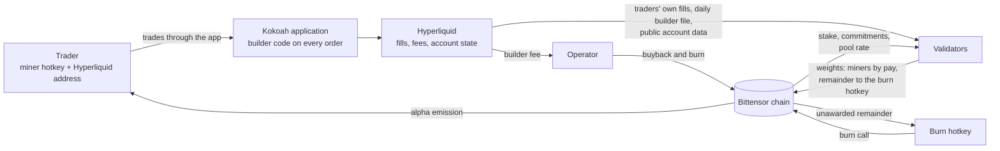
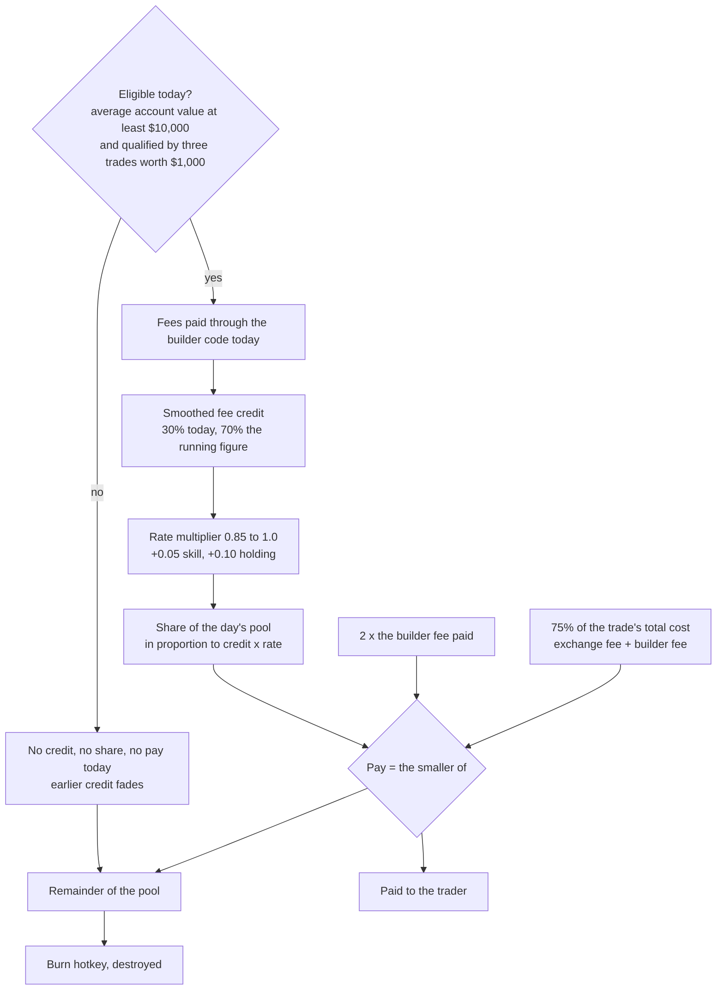

# Kokoah Subnet

## Verified trading activity as a Bittensor subnet

Whitepaper, version 1.3, October 2026. Mechanism specification v5.10.

### Summary

Kokoah Subnet brings real trading to Bittensor. Its miners are traders on Hyperliquid, one of the most active
perpetual-futures venues, who route their trades through the Kokoah application. Every routed trade pays a small
builder fee to the operator, and those fees buy back and burn the subnet token on chain, so revenue earned
outside Bittensor flows back into it. Validators score each trader from the exchange's own public records and from
chain state, so the work the subnet rewards is real, external and checkable by anyone. The pay rule is simple and
hard to game: a trader's share follows the fees they actually paid, adjusted by a small quality factor, and is
capped at a fraction of what the trade cost them, so no fake-volume strategy can profit. Rewards go to traders
with real capital at work, an account averaging at least $10,000 over the day, and emission the caps leave
unawarded is destroyed.

### Key facts

- **Miners are traders.** They register a hotkey, bind their Hyperliquid address with one signed line, and trade.
  They run no software and never expose keys.
- **Scored from public data.** Validators recompute everything from each trader's own fills on the exchange,
  cross-checked with the exchange's per-builder daily file, from each trader's public account history and from the
  chain; every validator reaches the same weights from the same inputs, and the fees credited to traders are
  checked against what the exchange reports the builder has earned.
- **Pay follows fees paid.** Equal activity, equal pay, within a 15% band set by skill and holding. Twice the
  activity, about twice the pay.
- **Real traders with real capital.** A trader earns on a day when the account's average value that day is at
  least $10,000, after three first trades worth $1,000 together. A day below the line simply earns nothing; the
  next day at or above it earns again.
- **Nobody is paid more than a fraction of what the trade cost them.** At most twice the builder fee, and at most
  three quarters of the exchange's fee and the builder fee together. Every fake-volume strategy loses at every fee
  tier of the exchange; checked, not hoped for.
- **Unawarded emission is destroyed.** What the caps leave over goes to a dedicated burn hotkey and is burned with
  the chain's burn call, one public transaction per burn.
- **Revenue returns to the network.** The builder fees buy back and burn the subnet token, each buyback one
  on-chain transaction.
- **Everything is on the record.** Every validator keeps a complete, queryable record of every fill, every figure
  and every decision, and serves the ranking and the daily artifacts over a read-only interface.
- **Status.** The mechanism and its parameters are fixed in this version; the validator software is complete and
  running on a test network; the remaining items are measurements, listed in section 9.

---

## 1. What the subnet brings to Bittensor

Bittensor's premise is that token emission should flow to measurable, useful work. Subnets that measure their
work against an external, independent source of truth are the easiest for the network to trust, and subnets that
bring revenue and participants from outside the network make the whole network stronger. Kokoah Subnet is built
to do both.

- **Revenue from outside the network.** Every routed trade pays a builder fee that the exchange itself charges and
  publishes. Those fees buy back and burn the subnet token on chain, transaction by transaction. Value earned on an
  external venue is returned to the network in a form anyone can verify.
- **New participants and capital.** Hyperliquid traders join Bittensor to take part: they register hotkeys, lock
  collateral, keep at least $10,000 at work in their trading accounts, and are paid in alpha that the holding
  factor rewards them for keeping. A trading community that had
  no reason to be on Bittensor gets one.
- **A verifiable data product.** The public ranking of traders, computed by independent validators from the
  traders' own fills, is a signal that did not exist before: who trades well, at what scale, with what
  consistency, with no self-reporting anywhere.
- **A path toward automated trading.** Kokoah is adding AI assistance to its platform so that trading is easier for
  everyone, which grows the number of traders the subnet can verify. The longer-term direction (section 10) is
  trading by AI agents on the platform, which the subnet measures exactly as it measures human trading.

Trading on a public exchange is a good source of truth. Every fill on Hyperliquid is a public record with a
price, a size, a side, a fee and a counterparty; account values and deposits are public; and the venue's builder
code attributes each fill to the application that routed it and charges a fee the venue publishes. A subnet built
on this data pays for an activity that is real, priced by an outside market and revenue-generating, without asking
the network to trust the operator's measurements.

The hard part is not measurement but incentives. Rewards for trading volume have a long record of attracting fake
volume. The mechanism below is built around one rule that is checked rather than hoped for: no strategy without a
trading edge can net a profit from the subnet, at any pool size and at any fee tier of the exchange. Everything
else follows from that rule.

## 2. How it works



Figure 1. The flow. Trades go through the application to the exchange; the exchange's fee funds the buyback; the
exchange's public data and the chain feed the validators; the validators' weights pay the traders and send the
unawarded remainder to be burned.

Once a day, after the UTC day closes, every validator reads which hotkey each address is bound to, reads each bound
address's own fills from the exchange together with the exchange's daily file of fills routed under the Kokoah
builder code, fetches each bound address's public account history and fee schedule, works out from the exchange's recorded account values whether each trader held at least
$10,000 on average through the day, reads stake and the pool rate from the chain, and scores the day. The weights it sets
every tempo pay each trader their share and direct the rest to the burn hotkey. Everything it fetched and decided
goes into its record and its daily artifact.



Figure 2. The pay rule. Only eligible traders take part on a day; the share follows fees paid; two caps bound
what any trader can receive; what the caps leave over, and the share nobody was eligible for, is destroyed.

## 3. Who does what

**Traders.** Register a hotkey on the subnet, sign one line with the Hyperliquid wallet (appendix D) and publish
it as the hotkey's commitment, then trade perpetuals through the Kokoah application. That is all. No software to
run, no keys to share, no reporting. Pay arrives as alpha on the hotkey every tempo; keeping it earns the holding
part of the rate; a consistent track record earns the skill part, and the exchange's own account history counts from the first day, so a
trader with a real record is recognized within days. To earn, a trader keeps an account averaging at least
$10,000 over the day and, once at the start, completes three trades worth $1,000 together; there is no waiting
period, so a trader can qualify on the day they register. A trader can move to a new address once per 60 days and
keep their track record, pay history and skill; the fee credit and the qualification start again with the new
address, as they do after a hotkey swap or a new registration. Coming back with a new identity starts from zero and
forfeits the unpaid part of the old credit, and a mirror report follows the address, not the hotkey.

**Validators.** Run the open-source validator with a hotkey and a database. It fetches public data, scores the
day, sets weights every tempo, keeps the record and serves the daily artifacts and the leaderboard over a
read-only interface. Any number of validators can run; they agree because the computation is deterministic over
public inputs.

**The network.** Receives revenue it did not have, through buybacks that anyone can check on chain; gains
registered, staked participants from a community outside Bittensor; and gets a verifiable ranking of traders as a
data product. Unawarded emission never reaches the market.

**The operator (Kokoah).** Runs the application that routes the trades, collects the builder fee the exchange
charges, commits each day's file hash on chain so validators can check theirs, runs the buyback and the burn
process, and publishes the code, the parameters and every change. What the operator cannot do is in section 7.

## 4. The pay rule

Every number below is a parameter of specification v5.10; the complete formulas are in appendix A.

**Eligibility.** A trader earns on a day when two things hold. The account's average value over that day is at
least $10,000, measured from the exchange's own recorded history of the account through the whole day, not from a
balance at one moment. And the trader has qualified: a new identity's first three trades, worth $1,000 together,
qualify it; the trade that completes both earns credit, the two before it do not. On a day that falls short, the
trader's activity, account value and skill are recorded as usual, but the day's trades earn no credit, the earlier
credit fades as it would on a quiet day, the trader takes no share of the pool and nothing is owed later. There is
no permanent exclusion: the first day back at $10,000 earns again.

**Fee credit.** A trader's credit for the day is the builder fee paid on their fills, 0.025% of notional on every
order, maker and taker alike. The credit is smoothed: 30% of today's fees count today, 21% tomorrow, 15% the day
after, and so on. The weights sum to one, so every dollar of fees is counted exactly once; smoothing only spreads
it, which keeps a burst of activity from moving the ranking for a single day.

**Rate multiplier.** The credit is multiplied by a rate between 0.85 and 1.0. Skill moves it by up to 0.05, holding
by up to 0.10. Two traders with the same activity are therefore always within 15% of each other, whatever their
skill or holding, so anyone can take part without fear of a score they cannot control.

**Share.** The day's miner pool is shared in proportion to credit times rate. Because the share is linear in fees
paid and the rate is bounded, splitting one account into many or merging many into one changes nothing (section
5).

**Caps.** Two caps bound what any trader receives. First, nobody is paid more than twice the builder fee they
paid. Second, nobody is paid more than three quarters of everything the trade cost them on the exchange, the
exchange's fee and the builder fee together. For an ordinary account the first cap binds; for an account with
large volume discounts and staking rebates, the second does. The second cap is what makes the mechanism safe at
every fee tier; the first sets how generous it is to ordinary traders. Caps are converted from dollars to alpha at
the day's average rate, never at a single block's value.

**The remainder.** When the pool is larger than the sum of the caps, the normal state of a young subnet, the
remainder is not paid to any trader. It is directed to the burn hotkey and destroyed (section 6).

**Skill.** The skill factor asks two questions of a trader's own daily returns, computed from account value with
deposits, withdrawals and vault transfers removed, with any money moved in through off-market fills removed as well
(so two accounts cannot manufacture a steady profit by trading each other at off-market prices), and each day
capped at ±10%. Is the edge statistically real? The probabilistic
Sharpe ratio of the last 60 days against a modest benchmark answers that. Are recent gains clearly larger than
recent losses? A recency-weighted gain-to-pain ratio of the last 30 days answers that, halved if two or more days
in the last 60 lost more than 10%. The two are multiplied, smoothed like the credit, and scaled so that a strong
trader scores 1. In simulation, accounts with no edge score 0.05 to 0.10, a steady trader about 0.3, a strong
one above 0.5. A single bad day is one capped loss that fades; a repeated pattern of blow-ups keeps counting.

**Holding.** The holding factor is the share of the last 60 days' pay that is still staked on the trader's own
hotkey, read as the day's minimum so staking for a block earns nothing; alpha bought on the market counts, the
registration collateral does not. Keep everything and the factor is 1; sell everything and it is 0; a fresh hotkey
starts at 0, so leaving and re-registering sheds nothing.

**Gates.** The skill and holding parts, and a place in the public ranking, need at least 10 completed round trips,
7 active days and a mean account value of $500 over the last 30 days. A trader failing a gate is paid at the floor
rate of 0.85, not excluded.

**What never counts.** Spot fills: the subnet scores perpetuals only in this version, and spot fills that carry the
builder code are recorded but not counted. Fills against the trader's own cluster (sub-accounts, addresses on the same coldkey,
addresses funded by or transferring with each other); fills against another bound address, since the subnet does
not pay for volume between its own miners (the exchange's file names every counterparty, so this is exact); and
fills priced more than 0.5% from the exchange's minute mark, which are valued at the mark. Persistent hedging
through the market is
caught by position: daily net positions correlated below −0.8 with another bound address on at least 10 days in the
last 30. Mirrored volume above 25% of an address's notional is removed from its credit; above 50%, both addresses
lose their rate bonus for 30 days and are reported.

**Parameters.** Builder fee 0.025%; smoothing 0.3 a day; rate 0.85 + 0.05 skill + 0.10 holding; caps 2× the fee
credit and 0.75× the total fees on the builder leg; skill windows 60 and 30 days; holding window 60 days; gates
10 round trips, 7 days, $500; eligibility $10,000 average account value a day and three qualifying trades worth
$1,000; mirror thresholds 25% and 50%; migration once per 60 days; emission split miner 41%,
owner 18% (locked), validators 41%. Changes follow section 7.

## 5. Why fake volume loses

The intuition first. Whatever a trader does to generate volume, the exchange charges its fee and the builder fee
on every fill of the builder leg. The subnet never pays more than three quarters of those two fees together. So
the builder leg alone loses at least a quarter of its cost, and any other leg, on another venue or in another
account, only adds cost. The only thing that can offset the loss is a maker rebate on the other leg, and the best
rebate the exchange offers is too small to close the gap.

In numbers, per round trip of notional, in basis points: let `C` be the total fees paid on the builder leg (the
exchange's fee plus the builder fee, both sides) and `H` the cost of the other leg. The subnet pays at most
`0.75 × C`, so the net is at most `−0.25 × C − H`. The smallest `C` on Hyperliquid is a maker at the deepest rebate
tier trading through the 2.5 bps builder fee, `C = 2 × (2.5 − 0.3) = 4.4`, and the most favorable other leg is the
same rebate, `H = −0.6`. Hence the net is at most `−1.1 + 0.6 = −0.5` bps per round trip: every zero-edge strategy
loses, at every pool size, at every fee tier, whatever the first cap is set to. The bound holds for any second-cap
ratio below 0.864; the chosen 0.75 leaves margin.

| Strategy (bps per round trip, builder fee 2.5 a side) | Exchange fee, builder leg | Builder fee | Other leg | Paid at most | Net |
|---|---|---|---|---|---|
| Wash: taker through the builder vs own maker elsewhere, base tier | 9 | 5 | 3 | 10 | −7 |
| Two bound accounts, taker vs maker, both through the builder | 12 | 10 | 0 | 16, and mirrored → 0 | −6 or worse |
| Hedge, taker through the builder, hidden maker leg elsewhere | 9 | 5 | 3 | 10 | −7 |
| Hedge, taker at the deepest volume and staking discounts (1.44 a side), hidden leg at the best rebate | 2.88 | 5 | −0.6 | 5.91 | −1.37 |
| Market maker at the deepest rebate, maker both legs, one through the builder | −0.6 | 5 | −0.6 | 3.3 | −0.5 |
| Instant round trips in one account, base tier | 9 | 5 | 0 | 10 | −4 |
| Farm of small accounts | 9 | 5 | 0 | 0 below $10,000 average equity, else 10 | −14 or −4 each |

The tightest case, the rebated market maker, would need a hidden rebate of 0.55 bps a side to break even, almost
twice the best rebate the exchange offers. A search over 105 combinations of volume tier, staking discount and
maker or taker on the builder leg found no positive case, and a 60-day replay of these strategies through the
real scoring code, beside honest traders and recorded public fills of real accounts, ended negative for every one
of them while the honest traders received their proportional share.

**Splitting and merging change nothing.** Shares and caps are linear in fees paid and the rate is bounded, so one
account and the same fills spread over two or five accounts receive the same total. This is the proportional
allocation rule, which Chen, Papadimitriou and Roughgarden (2019) show to be the unique rule that is
budget-balanced, symmetric, sybil-proof and weakly collusion-proof. What is not linear works against splitting:
each registration costs a burn and locks collateral, each account must hold $10,000 on average and qualify with
its own three trades before it earns anything, each account must pass the gates on its own, and the holding target
is per hotkey.

**Honest high-frequency trading is welcome.** Scalpers and market makers earn credit on every fill like everyone
else and are paid less than their costs like everyone else; whether that trade-off is worth it is their decision,
exactly as with a fee rebate program on any exchange.

## 6. Sustainability

**Fees first.** Each day's pay is at most twice the smoothed fee credit, and the smoothing weights sum to one, so
up to any day the alpha paid out, counted in dollars when it was paid, is at most twice the builder fees collected
so far. On 200 random paths of fees, rates and miner populations the worst ratio of paid to collected was 1.36.
While the operator's builder fee is zero, as it is under the application's launch promotion, nothing is paid and
the whole pool is destroyed: the subnet does not pay for activity that produced no revenue.

**Burn.** The unawarded remainder of the pool is directed to a dedicated burn hotkey, registered by the operator on
a coldkey of its own, bound to no trader and scored as no miner. A separate operator process burns what lands there
with the chain's `burn_alpha` call, signed by that coldkey; every burn emits a `TokensBurned` event, and the daily
artifact records how much was directed there, so the two can be reconciled by anyone. The burn hotkey is separate
from the subnet owner's hotkey because the chain treats emission directed to owner hotkeys as a reason to scale
the subnet's TAO emission share; the subnet's own burn removes unawarded alpha without changing what its miners
and validators receive. On a local chain, with 85% of the miner pool directed to one hotkey and burned, alpha
emission to the other participants continued at its full rate.

**Buyback.** The operator spends the collected fees on buying back and burning the subnet token on a published
cadence, every two to three weeks, each time as one `add_stake_burn` transaction that buys alpha with TAO and burns
it in a single call. A coverage figure, cumulative buyback over cumulative alpha sold by miner hotkeys, is
published for information.

**The conversion rate.** The caps convert dollars to alpha at the day's mean pool rate over 20 tempo samples. A 30%
move engineered at the scoring block would change the alpha cap by 43% at a single-block rate and by 1.5% at the
mean; holding the rate there for a whole day against everyone else is not a cheap manipulation.

**The owner's share.** The owner's 18% of emission is locked by enabling the chain's `owner_cut_auto_lock_enabled`
hyperparameter, so the operator never sells into its own buyback.

## 7. What the operator cannot do

The weights that pay traders are set by validators, not by the operator. Validators run the open-source code on
public inputs: each trader's own fills and account history on the exchange, the exchange's per-builder file, and
chain state. The
operator's only input to scoring is the hash of the day's file, committed on chain from the owner hotkey, which
validators compare with the hash of the file they fetched themselves from the exchange; a mismatch is published.
The operator cannot add a fill, change a figure, pay a favorite or withhold a payment: any validator would compute
a different result and the chain's consensus would show it. Every validator also compares the builder fees it
credits to traders with what the exchange reports the builder has earned, and raises an alarm if the credited
fees are ever larger: every fee the subnet pays for must have reached the builder.

Parameters are part of the versioned code. A change is announced at least seven days before it takes effect,
recorded in the changelog (appendix F), and published in every daily artifact as the mechanism's version number.
Validators adopt it by updating; nothing changes until they do.

Every validator keeps a complete relational record of what it saw and decided: every builder fill, from the
trader's own history or the builder file, with its source, whether it counted and why not, every per-miner figure with the parts behind it (confidence, quality,
smoothed credit and fees, holding inputs, gate counts, mirror shares, caps and pay), every eligibility decision with
its reason, every account value with the recorded points behind each day's average, every ledger entry and
position, every commitment and binding decision, every pool and stake sample, every epoch's payout per
UID as the chain made it, every weight submission, every burn, every error. Each day's artifact is published
with its figures per miner, the file hash and whether it matched the operator's commitment, refused bindings with
their reasons, and the abuse signals; the ranking and the artifacts are served over a read-only interface
(appendix E) by every validator, so the ranking can be read from any of them.

## 8. Growth

The subnet's growth is measured in things anyone can count on chain or at the exchange, and never in the
subnet token's market.

**Stage one: the first traders.** A handful of Hyperliquid traders bind their addresses through the Kokoah
application. Volume through the builder code is small, the builder fee funds small buybacks, and most of the pool
is destroyed each day. What matters at this stage is that every number is produced and published as designed:
fills counted, ranks computed, weights set, burns executed, the record complete.

**Stage two: a venue's worth of traders.** The application's assistance features bring traders who would not have
used a Bittensor subnet on their own. Volume through the builder code grows into the tens of millions of dollars a
day, the builder fee into thousands of dollars a day, and the pool starts to be shared rather than mostly
destroyed. Buybacks become regular, each one a public transaction. The ranking becomes a reference: a trader's
place in it is earned from their own fills, verified by independent validators.

**Stage three: the pool is scarce.** Routed volume reaches hundreds of millions of dollars a day. The sum of the
caps exceeds the pool, nothing is destroyed, and the pool works as a volume rebate returning a fixed fraction of
fees to the traders who generated them, shared within 15% for equal activity. Revenue from outside the network
returns to it every two to three weeks; a trading community is a registered, staked part of Bittensor; and the
operator's platform, with AI assistance and later with agents trading on it, keeps widening the funnel.

Every stage is read from the same record: traders bound, volume routed, fees collected, alpha paid, alpha burned,
buybacks executed.

## 9. Verification

**Done.** The one law searched over 105 fee cases and proven in closed form; cumulative backing on 200 random
paths; the 15% rule in both pool regimes; sybil neutrality for one, two and five accounts; the conversion rate under
a 30% single-block move; the skill factor calibrated on simulated track records (luck, lottery, martingale,
grinder, real edge, strong edge, fading edge, one bad day); a 60-day adversarial replay through the real scoring
code, with a month of recorded public fills of four of the most active Hyperliquid accounts (one of them a
scalper with 15,471 fills in the month) beside the synthetic ones, in which every zero-edge strategy ended negative
and honest traders were paid proportionally; the replay also found and removed a timing heuristic that flagged
honest traders by coincidence. Two independent validators on the test network scored the same day with the same
file hash and identical weights. On a local chain: directing most of the miner pool to one hotkey and
burning it leaves alpha emission to everyone else unchanged. On a test-network subnet with the real public data:
each trader's own fills merged with the per-builder daily file recover every builder fee the exchange credits to
the operator's builder, to the cent, with every row of the daily file matched; bindings publish and resolve
on chain, the validator scores complete days into its record and submits weights; the chain paid the whole
unawarded pool of an epoch to the burn hotkey, and the operator's burn process destroyed it with one `burn_alpha`
transaction. Eligibility is tested end to end: a fall below $10,000 pays nothing that day and only lets earlier
credit fade, recovery pays again from the first day back with nothing owed for the days missed, the first two
qualifying trades earn nothing and the third does, an order filled in pieces counts as one trade, a new address,
hotkey swap or new registration restarts credit and qualification while keeping the pay history and penalties,
and the same inputs in any order give identical results. The verification script, the simulations and the chain
measurements are in the repository.

**Before mainnet.**

1. The burn process on the test network over a month: alpha directed to the burn hotkey each day against alpha
   actually burned, published side by side.
2. The replay extended with coordinated groups and with one trader on several wallets over recorded histories.
   Pass criterion unchanged: no zero-edge strategy nets positive at any pool size, and genuine high-volume traders
   receive their proportional share.
3. Holding: selling by traders at factor 1 against factor 0 on the test network.
4. The merged fills checked against the builder's earnings on real bound traders over a month of data.

**Assumptions.** Each trader's own fill history is complete and names every builder fee, but not the builder; the
exchange's per-builder daily file names the builder and has so far covered about the first half of each day. The
validator merges the two: a fill seen only in the history counts when the operator's builder is the only one the
trader has approved, or when it carries the application's order marker at exactly the operator's fee, and the
earnings check catches anything else. The history keeps 10,000 fills per account, and the daily file covers the
rest for the busiest accounts. Validators score days in order, wait for the day's file until twelve hours after
the day ends, and then score from the histories. The caps need the builder fee to stay above 0.015%, which the
validator checks every day. The TAO/USD rate is the day's mean of the exchange's own TAO perpetual, with a configured fallback.
The day's average account value comes from the exchange's own recorded history of the account, about one point
every two hours; validators read it while the day is within the exchange's seven-day window, keep the points they
read, and treat a day with too few points as unknown rather than estimate it; a failed read delays the day's
scoring and never makes a trader ineligible. Whether, and when, root enables emission for a new subnet is the network's decision, not the
operator's. Paying tokens for trading activity is subject to legal review in the operator's jurisdictions.

## 10. Roadmap

Done: the scoring library with its tests, the validator with its record and interface, the binding flow, the burn
measurement on a local chain, the replay harness, and a test-network subnet with a running validator.

Next: real traders bound on the test network for at least a month, the measurements of section 9 from that period,
the operator's builder fee switched on, and then mainnet, only after the verification list is complete and
published, with the parameters the test-network period supports.

Beyond the subnet itself, Kokoah's platform keeps adding AI assistance so that trading is easier for everyone:
help with reading the market, with sizing and managing positions, and with learning from one's own record, the
same record the subnet verifies. That grows the number of traders the subnet verifies and the revenue it returns to
the network. The long-term direction is trading by AI agents on the platform, scored by the same mechanism and
verified from the same public data; that is a direction for later versions, not a feature of this one.

## 11. References

- Bailey, D. H., and M. López de Prado (2012). The Sharpe ratio efficient frontier. Journal of Risk 15(2).
- Chen, Y., C. Papadimitriou, and T. Roughgarden (2019). An axiomatic approach to block rewards. arXiv:1909.10645.
- Cong, L. W., X. Li, K. Tang, and Y. Yang (2023). Crypto wash trading. Management Science; NBER w30783.
- Victor, F., and A. M. Weintraud (2021). Detecting and quantifying wash trading on decentralized cryptocurrency
  exchanges. arXiv:2102.07001.
- Hyperliquid documentation: fees, builder codes, info endpoint.
  https://hyperliquid.gitbook.io/hyperliquid-docs/trading/fees ·
  https://hyperliquid.gitbook.io/hyperliquid-docs/trading/builder-codes ·
  https://hyperliquid.gitbook.io/hyperliquid-docs/for-developers/api/info-endpoint
- Bittensor (Rao Foundation) subtensor: emissions, emission weights, `run_coinbase.rs`, `subnet_emissions.rs`.
  https://github.com/RaoFoundation/subtensor

---

### Appendix A. The formulas

Notation: `i` a miner, `d` a scoring day (00:00 UTC), `f` a fill of miner `i` carrying the builder code, `n_f` its
notional in USD, `b_f` the builder fee it paid (0.025% of notional, maker or taker), `fee_f` the fill's total fee
field (the exchange's fee plus the builder fee; a maker rebate makes the exchange's part negative). `A` is the
day's miner emission (41% of 7,200 alpha, 2,952 alpha). `p_d` is the day's conversion rate from dollars to alpha:
the mean pool rate (TAO per alpha) at 20 blocks anchored to the scored day (identical for every validator), times
the day's mean TAO/USD from the exchange's hourly TAO-perpetual candles.

```
Φ_i,d     = Σ_f  b_f                                            fee credit of the day
Φ̂_i,d     = 0.7 × Φ̂_i,d−1 + 0.3 × Φ_i,d                           smoothed credit
F̂_i,d     = 0.7 × F̂_i,d−1 + 0.3 × Σ_f fee_f                       smoothed total fees on the builder leg
M_i,d     = 0.85 + 0.05 × g'_i,d + 0.10 × h'_i,d                   rate multiplier, g', h' ∈ [0, 1]
share_i,d = A × Φ̂_i,d × M_i,d / Σ_j Φ̂_j,d × M_j,d                  share of the pool, in alpha
cap_i,d   = M_i,d × min( 2 × Φ̂_i,d ,  0.75 × F̂_i,d ) / p_d        cap, in alpha
pay_i,d   = min( share_i,d , cap_i,d )
burn_d    = A − Σ_i pay_i,d                                       weight to the burn hotkey
```

Skill, from daily returns `r_d = (E_d − E_d−1 − flows_d − offmarket_d) / E_d−1` (flows: deposits, withdrawals,
account and vault transfers; offmarket: money moved in through off-market fills) capped to
`r̃_d = clip(r_d, −0.10, +0.10)`:

```
confidence = clip((PSR − 0.5) / 0.45, 0, 1)        PSR: probabilistic Sharpe ratio of the last 60 days of r̃,
                                                    skew- and kurtosis-adjusted, against a daily Sharpe of 0.03;
                                                    0.5 with fewer than 10 days
quality    = clip((GPR − 1) / 1.2, 0, 1)            GPR: gain-to-pain of the last 30 days of r̃ with weights
                                                    0.5^(age / 10 days); halved if 2+ days < −10% in the last 60
g_raw      = confidence × quality
g_i,d      = 0.7 × g_i,d−1 + 0.3 × g_raw
g'_i,d     = min(1, g_i,d / 0.65)
```

Holding: `h'_i,d = min(1, (staked_i,d − collateral) / max(target_i,d, 1))`, with `staked` the day's minimum alpha
staked on the hotkey by its own coldkey, `collateral` the registration collateral locked on it, and `target` the
alpha paid in the last 60 calendar days.

Gates, over 30 days: at least 10 round trips, 7 active days, $500 mean account value; otherwise `M = 0.85`.

Eligibility, each day: `Ē_i,d = (1/24 h) × ∫ E_i(t) dt` over the day, from the exchange's recorded account values
joined by straight lines (at least 4 recorded points in the day; otherwise unknown, and unknown is not eligible),
and qualification: the first 3 trades (executions of one coin and side at one instant) with at least $1,000 of
eligible notional together, the first two uncredited. A miner with `Ē_i,d < $10,000` or not yet qualified has
`Φ_i,d = 0` and no fees added to `F̂`, is left out of `Σ_j`, and has `pay_i,d = 0`. Credit and qualification
restart with a new address, a hotkey swap or a new registration.

Exclusions: fills against the same cluster and against other bound addresses removed; fills more than 0.5% from
the mark valued at the mark; daily net positions per coin correlated below −0.8 with another bound address on at
least 10 of the last 30 days count as mirrored; mirrored notional above 25% removed from credit, above 50% the rate
bonus zeroed for 30 days and the pair reported.

The one law: with `C` the total fees on the builder leg and `H` the other leg's cost per round trip,
`net ≤ −(1 − 0.75) × C − H ≤ −0.25 × 4.4 + 0.6 = −0.5` bps, negative for any second-cap ratio below 0.864.

### Appendix B. Worked example

A young subnet: fees today $2,000 on $8M of volume, and a daily miner pool worth far more than the sum of the caps.
Two eligible miners, both qualified and holding well over $10,000 on average through the day, equal volume of
$4M, all taker at the base tier, smoothed credit $1,000 each, total fees on the
builder leg $2,800 each. Miner A has strong skill and holds everything (rate 1.0); miner B has no skill and sold
everything (0.85). Caps: min(2 × 1,000, 0.75 × 2,800) = $2,000, times the rate: A is paid alpha worth $2,000 and B
alpha worth $1,700; the rest of the pool is destroyed. Same volume, pay within 15%; total pay $3,700 against
$2,000 of fees collected, covered if the two keep at least 46% of it.

A busy subnet: fees $87,700 a day on $350M of volume. The sum of caps exceeds the pool; nothing is destroyed; the
pool works as a volume rebate returning about 18% of fees, with shares within 15% for equal volume.

A third miner on either day whose account averaged $8,000 is recorded with its volume and skill, earns no
credit, takes no share and is paid nothing; its earlier credit fades by 30%. On its next day at or above $10,000
it earns again, from that day's trades.

### Appendix C. A validator's day

1. Fetch the previous UTC day's per-builder fill file (waiting up to twelve hours after the day for it); verify its
   hash against the operator's on-chain commitment.
2. Read every commitment on the subnet; resolve which address each hotkey is bound to.
3. For each bound address: fetch its own fills and the builders it has approved, merge them with the daily file
   (the fills the file confirms, and the history's fills that are the builder's), name counterparties by trade id
   against the other bound addresses and the linked accounts; check the off-market fills against the exchange's
   minute candles; read account value and ledger for returns and flows, positions, the fee schedule,
   sub-accounts and transfer partners for clusters; read the day's minimum own stake and the pool rate from the
   chain at blocks anchored to the day; read the account's recorded value history for the day's average. A failed
   read never costs the trader the day's credit; a failed read of the fill history or of the value history delays
   the day's scoring instead, so it never costs a trader a fill or makes a trader ineligible.
4. Read the account's recorded history and compute each trader's average account value for the day; walk the
   day's trades for qualification; update smoothed credit (eligible trades only), total fees and skill; compute holding, gates, the rate; compute shares, caps in alpha at
   the day's mean rate, pay, and the remainder.
5. Write everything to the record; publish the per-miner artifact; set weights (miners by pay, the remainder to the
   burn hotkey) every tempo until the next run.

### Appendix D. Binding format

The Hyperliquid address signs, as an Ethereum personal message (EIP-191), exactly this line:

```
kokoah-bind-1 netuid=<netuid> hotkey=<hotkey ss58> address=<0x address, lowercase>
```

The hotkey publishes the result as its commitment on the subnet: one raw field of 116 characters, the base64 of
`"K1"` + the 20-byte address + the 65-byte signature. A migration adds a second field, `"P1"` + the previous address
+ its signature over the same line (the line names the new address). Validators recover the signer from each field
and accept the binding only when it is the named address. The chain keeps only a hotkey's latest commitment, so
each validator enforces the 60-day limit from the bindings it has itself accepted; a validator that starts later
accepts the current commitment on its signatures alone and agrees with the others from then on.

### Appendix E. Validator interface

Read-only, served by every validator: `/days` (scored days), `/days/latest` and `/days/{day}` (the full daily
artifact: per-miner credit, factors, rate, share, cap, pay; the remainder; weights; file hash and whether it
matches the operator's commitment; refused bindings; errors), `/bindings`, `/leaderboard` (the ranking with totals
over all days, each trader's eligibility for the day with the reason when not, the day's average account value
and qualification progress), `/summary` (alpha paid and burned, builder fees, paid-to-fees ratio over all days), and `/` (the
leaderboard page).

### Appendix F. Changelog

- **1.3 (2026-10-22).** Mechanism v5.10: each trader's own fills on the exchange are the primary source, merged
  with the per-builder daily file (which has covered about the first half of each day), counterparties named by
  trade id, a day's scoring no longer held back by a missing file, and the credited fees checked against the
  builder's earnings on the exchange.
- **1.2 (2026-10-22).** Mechanism v5.9: eligibility. A trader earns on days the account averages at least
  $10,000, after three qualifying trades worth $1,000 together; ineligible days earn no credit and no pay and
  nothing is owed later; credit and qualification restart with a new address, a hotkey swap or a new
  registration, while the track record, pay history and penalties stay. The summary, both figures, the attack
  table, the verification list, the worked example, the validator's day and the interface describe it.
- **1.1 (2026-10-21).** Off-market fills valued at the exchange's minute marks and their transfers removed from
  the returns; the day's TAO/USD from hourly candles; chain samples anchored to the scored day; vault transfers as
  flows; a failed exchange read never costs the day's credit; re-scores start from the state before the day; the
  builder file is re-checked later in the day. Leaving, returning and switching handled: departed hotkeys release their address, a mirror
  report follows the address, hotkey swaps carry the records, the exchange's account history counts from the first
  day, collateral no longer counts as holding, the burn hotkey always keeps a minimal slice. Perpetuals only: spot fills are recorded but not counted. Emission split set to owner 18%, validators 41%, miners 41% (the chain's default; the
  miner pool is 2,952 alpha a day). Restructured for readers who are not engineers: summary and key facts, two figures, a
  section per role, the pay rule in prose with the formulas moved here, what the operator cannot do, growth
  stages. Mechanism unchanged (v5.8).
- **1.0 (2026-10-20).** Mechanism v5.8. Since draft 0.9: the builder fee is confirmed to be charged on maker fills
  (one rate on every order), so maker and taker fills earn the same credit; the 60-second timing rule for mirrored
  fills is replaced by the exact counterparty rule; the conversion rate is the day's mean pool rate; the holding
  factor reads the day's minimum stake; the unawarded remainder goes to a dedicated burn hotkey and is destroyed
  with `burn_alpha` by a separate operator process; validator, binding flow and interface implemented and running on
  a test network.
- **0.9 (2026-10-20).** First public draft.
