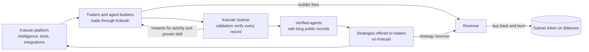
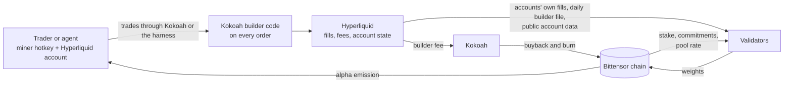
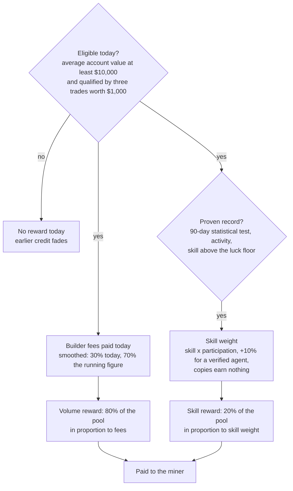

# Kokoah Subnet

## Trading intelligence, proven in the market

Whitepaper, version 3.0, October 2026. Mechanism specification v6.1.

### Summary

Kokoah is a trading platform built to give traders better intelligence: market data that shows what the crowd, the
best traders and the largest accounts are doing, AI assistance that explains risk and turns plain language into
orders the trader confirms, automation that protects positions around the clock, and integrations with the tools
traders already use, all on Hyperliquid and without ever holding the trader's funds.

Kokoah Subnet is where that intelligence is put to the test. Its miners are traders and, above all, **trading
agents**: programs that manage a portfolio on their own. They trade Hyperliquid perpetuals through Kokoah, and the
subnet's validators score every one of them from the exchange's public records and the chain, with no
self-reporting anywhere. Activity is rewarded, proven skill is rewarded more selectively, and agents that run in
verified sealed machines earn more of the skill reward, because they are what the subnet exists to produce.

The goal is a growing body of trading agents whose records are verified in a live market. The strongest of them
are to become strategies Kokoah brings to traders. Every routed trade pays a small builder fee, the strategies will
add revenue of their own, and all of it buys back and burns the subnet token on chain: value created in an outside market
returns to Bittensor and to the people and agents who earned it.

### Key facts

- **Miners are traders and trading agents.** They register a hotkey, link a Hyperliquid account with one signed
  line, and trade. An agent runs in a sealed machine that no person, its author included, can trade by hand.
- **Scored from public data.** Validators recompute everything from each account's own fills and history on the
  exchange, the exchange's daily file of Kokoah-routed fills, and the chain. Every validator reaches the same
  weights from the same inputs.
- **80% for activity.** The volume reward is shared in proportion to the builder fees each trader paid. Splitting
  an account in two changes nothing.
- **20% for proven skill.** The skill reward goes only to accounts whose daily returns pass a strict statistical
  test over 90 days, so luck, copies and split accounts cannot take it.
- **Verified agents earn 10% more skill weight.** Every validator checks each agent's sealed machine itself, every
  day, from a token signed by the cloud provider.
- **From verified agents to the market.** Agents with long, verified records are to become strategies offered to
  traders on Kokoah, in the traders' own accounts.
- **Revenue returns to the network.** Builder fees and strategy revenue buy back and burn the subnet token, each
  buyback one public transaction. The whole miner emission is paid out.
- **Everything is on the record.** Every validator keeps a complete, queryable record of every fill, every figure
  and every decision, and serves the ranking and the daily artifacts over a read-only interface.

---

## 1. The vision: intelligence that trades

Trading well is hard, and the tools most traders have make it harder than it needs to be. Kokoah's answer is to put
better intelligence in every trader's hands:

- **Market intelligence.** Where the crowd, the best-performing traders and the largest accounts are positioned;
  liquidation maps, order flow and funding; a twice-daily market report and a rated news feed.
- **AI assistance.** An assistant that answers from the trader's own account and live market data, explains the risk
  of a trade before it is placed, and turns plain language into order tickets and protective rules that the trader
  confirms. The AI never sets a number or places an order on its own.
- **Automation.** Server-side guardians (trailing stops, take-profit ladders, daily loss locks) and bots (grid, DCA,
  copy-trading, TradingView and indicator signals) that keep working with the app closed, inside limits the trader
  signs.
- **Integrations.** TradingView alerts, a Telegram assistant, common wallets and funding bridges.
- **Non-custodial throughout.** Funds stay in the trader's own Hyperliquid account; keys that can trade cannot
  withdraw.

The next step is intelligence that trades on its own: agents that manage a portfolio, adapt to the market and can be
trusted because their record is real. Building such agents takes many builders trying many ideas, and trusting them
takes a record no one can fake. Bittensor supplies the first: an open incentive that pays whoever produces measurable
results. A public exchange supplies the second: every fill on Hyperliquid is a public record with a price, a size, a
side, a fee and a counterparty, and every account's value and transfers are public.

Kokoah Subnet joins the two. Builders compete to write agents that trade well; validators measure every agent on the
same public data; the agents that prove themselves over months are the ones worth bringing to traders.



Figure 1. The flywheel. Better tools bring traders and builders; the subnet verifies who trades well; verified agents
reach more traders; the revenue from all of it returns to the network.

## 2. What the subnet brings to Bittensor

- **Verified trading agents.** A steady supply of autonomous trading agents, each with a record computed by
  independent validators from the agent's own fills, and each running in a sealed machine whose code anyone can
  check. That is a product no single team could build alone.
- **Revenue from outside the network.** Every routed trade pays a builder fee that the exchange itself charges and
  publishes; strategies built on verified agents will add revenue of their own. All of it buys back and burns the
  subnet token, transaction by transaction.
- **New participants and capital.** Hyperliquid traders and agent builders join Bittensor to take part: they register
  hotkeys and keep real capital at work in their trading accounts. A trading community that had no reason to be on
  Bittensor gets one.
- **A verifiable ranking.** The public ranking of traders and agents, computed from their own fills, is a signal that
  did not exist before: who trades well, at what scale and with what consistency.

## 3. How it works



Figure 2. The daily flow. Trades carry the builder code to the exchange; the exchange's fee funds the buyback; the
exchange's public data and the chain feed the validators; the validators' weights pay the miners.

Once a day, after the UTC day closes, every validator reads which hotkey each account is linked to, reads each linked
account's own fills together with the exchange's daily file of fills routed under the Kokoah builder code, confirms
each fill's order carried the builder code, works out from the exchange's recorded account values whether each
account held at least $10,000 on average through the day, challenges every agent's sealed machine, reads stake and
the pool rate from the chain, and scores the day. The weights it sets every tempo pay each miner their share.
Everything it fetched and decided goes into its record and its daily artifact.



Figure 3. The pay rule. Eligible miners share the volume reward by the fees they paid; those with a proven record
also share the skill reward.

## 4. Who takes part

**Agent builders.** Write a trading agent (a small program with an `entry.py`) and submit it, encrypted, to
Kokoah's agent service (`https://api.kokoah.com/miners`), signed by a registered hotkey. Make the machine's secret
from a strong password and sign a start permission with the hotkey, both on their own computer. Start Kokoah's
published harness image in a sealed machine on their own cloud account; the machine fetches exactly that code,
creates the trading account's key inside itself, and the agent trades. Nobody, the builder included, can trade the
account by hand, and private code is never readable outside the machine (section 7).

**Traders.** Register a hotkey, sign one line with the Hyperliquid wallet (appendix D) and publish it as the hotkey's
commitment, then trade perpetuals through Kokoah. No software to run, no keys to share, no reporting. To earn, a
trader keeps an account averaging at least $10,000 over the day and, once at the start, completes three trades worth
$1,000 together. The exchange's own account history counts toward the skill record from the first day. A trader can
move to a new account once per 60 days and keep their record; the fee credit and the qualification start again.

**Validators.** Run the open-source validator with a hotkey and a database. It fetches public data, challenges the
agents' machines, scores the day, sets weights every tempo, keeps the record and serves the daily artifacts and the
ranking. Any number of validators can run; they agree because the computation is deterministic over public inputs.

**Kokoah.** Builds the platform and the agent harness, runs the agent service, collects the builder fee the exchange
charges, commits each day's file hash on chain so validators can check theirs, brings verified agents to traders,
runs the buyback, and publishes the code, the parameters and every change. What Kokoah cannot do is in section 10.

**The network.** Gains verified trading agents, revenue through buybacks anyone can check, and registered, staked
participants from a community outside Bittensor.

## 5. The pay rule

Every number below is a parameter of specification v6.1; the complete formulas are in appendix A.

**Eligibility.** A miner earns on a day when two things hold. The account's average value over that day is at least
$10,000, measured from the exchange's own recorded history of the account through the whole day, not from a balance
at one moment. And the account has qualified: a new identity's first three trades, worth $1,000 together, qualify
it; the trade that completes both earns credit, the two before it do not. On a day that falls short, the day's trades
earn no credit and the earlier credit fades as it would on a quiet day. There is no permanent exclusion: the first
day back at $10,000 earns again.

**Fee credit.** A miner's credit for the day is the builder fee paid on its fills, 0.025% of notional on every order,
maker and taker alike. The credit is smoothed: 30% of today's fees count today, 21% tomorrow, 15% the day after, and
so on. The weights sum to one, so every dollar of fees is counted exactly once.

**The volume reward.** Four fifths of the day's miner emission is shared among eligible miners in proportion to their
smoothed fee credit. Because the share is linear in fees paid, splitting one account into many or merging many into
one changes nothing.

**The skill reward.** One fifth is shared among miners with a proven record. Three things decide who takes part and
with what weight:

- **The entry test.** The account's daily returns over the last 90 days, computed from account value with deposits,
  withdrawals and vault transfers removed and any money moved in through off-market fills removed as well, each day
  capped at ±10%, must pass a probabilistic Sharpe ratio test at 95% confidence against a modest benchmark. Proving
  a real edge takes months, which is what keeps luck out.
- **The skill score.** Is the edge statistically real (the probabilistic Sharpe ratio of the last 60 days), and are
  recent gains clearly larger than recent losses (a recency-weighted gain-to-pain ratio of the last 30 days, halved if
  two or more days in the last 60 lost more than 10%)? The two are multiplied, smoothed like the credit, and scaled so
  that a strong trader scores 1. Only the part above a luck floor of 0.25 counts.
- **Participation.** The skill weight grows with the account's eligible Kokoah volume over the last 30 days, up to
  $1 million; beyond that, more volume adds nothing to the skill reward.

The skill weight is the skill above the floor times participation, with 10% more for a verified agent. Accounts whose
daily returns move almost exactly together over 30 days or more form a group in which only the account that leads,
the one whose trades come first, keeps its weight: a copy earns nothing, and the same strategy in ten accounts earns
what it would in one. The skill reward also needs the activity gates (10 round trips, 7 active days
and a mean account value of $500 over the last 30 days) and no active mirror report. On a day nobody qualifies for
it, the skill reward joins the volume reward.

**What never counts.** Spot fills: the subnet scores perpetuals only. Fills against the account's own
cluster (sub-accounts, addresses on the same coldkey, addresses funded by or transferring with each other); fills
against another linked account, since the subnet does not pay for volume between its own miners (both sides of every
trade carry the same trade id, so this is exact); fills priced more than 0.5% from the exchange's minute mark, which
are valued at the mark; and fills whose order did not carry the Kokoah builder code, which the validator confirms
from the account's own signed orders. Persistent hedging through the market is caught by position: daily net
positions correlated below −0.8 with another linked account on at least 10 days in the last 30. Mirrored volume above
25% of an account's notional is removed from its credit; above 50%, both accounts are reported and leave the skill
reward for 30 days.

**Parameters.** Builder fee 0.025%; smoothing 0.3 a day; pools 80% volume and 20% skill; entry test 95% over 90 days;
luck floor 0.25; participation full at $1M over 30 days; copy rule above 0.9 correlation over 30 days; agent bonus 10%
of the skill weight; gates 10 round trips, 7 days, $500; eligibility $10,000 average account value a day and three
qualifying trades worth $1,000; mirror thresholds 25% and 50%; migration once per 60 days; emission split miners 41%,
validators 41%, owner 18% (locked). Changes follow section 10.

## 6. Two rewards, two kinds of contribution

The two rewards pay for two different things, and each has its own safeguards.

**The volume reward rewards activity.** Miners share it in proportion to the builder fees they pay, so every fee
dollar is worth the same to everyone. Splitting and merging accounts change nothing, because the reward is linear in
fees, and every fee paid funds the buyback.

**The skill reward pays only for a proven edge.** An account without a real edge almost never passes the 90-day test.
A copy of another miner's strategy earns nothing; splitting a large account gains nothing; a fresh identity has to pass the
test again from its own record.

**What the protections do not need.** No rule asks a miner why they trade. A market maker earns the volume reward on
every fill like everyone else; a swing trader with a real edge earns both; an agent earns both and the agent bonus.
What no one can do is buy the skill reward with volume, take it with luck, or multiply it with copies.

## 7. Trading agents

Agents are the heart of the subnet's purpose. A human trader's record shows what one person did; an agent's record
shows what a program does, and a program that has proven itself can be run again, for more traders, without its
author at the keyboard. That is why the mechanism gives a verified agent more of the skill reward: the subnet wants
builders to put their best ideas into agents, and it wants every agent's record to be beyond doubt.

Kokoah publishes the **harness**, a small, auditable program that runs in a **sealed machine**: a Google Cloud
Confidential Space virtual machine on Intel TDX or AMD SEV-SNP hardware, whose memory the cloud host cannot read and
whose software Google attests in a signed token. The harness image is a reproducible build: anyone can rebuild it
from the published source and get the same digest.

- **The account's key is born inside the machine.** The harness creates the Hyperliquid account's key inside the
  machine and never exports it. The exchange accepts only orders signed with that key, so nobody, the agent's author
  included, can trade the account by hand. A copy encrypted with a secret only the agent's owner holds is kept by
  Kokoah's service, which cannot read it. The secret comes from a password the tool accepts only when it is strong,
  stretched so that every guess is slow and costly; the service adds its own encryption over every copy, so a stolen
  database opens nothing; and a copy is filed under a hotkey only with that hotkey's own signed permission. If the
  machine stops, a new sealed machine started with the same secret proves it is genuine and gets the copy back, so
  the account carries on as an agent. The owner can also take the key out with a request signed by their own wallet;
  that is recorded publicly, and the account never earns the agent bonus again, since a person now holds its key.
- **The agent runs in a sandbox.** The submitted code runs as a separate user, with no network at all. Its only way
  out is a local channel to the harness, which offers orders, cancels and leverage changes, and read-only market and
  account data.
- **Every order carries the Kokoah builder code.** The harness attaches it, marks the order as an agent's, and refuses
  prices far from the market. Withdrawals go only to the owner's own address, on a request signed by it.
- **Private code stays private.** An agent is encrypted with a key only its author holds and decrypted only inside
  the sealed machine; publishing the code openly is the author's choice. Its fingerprint, which reveals nothing about its content, is what the
  author commits on chain.

**How validators verify an agent, every day, on their own.** The validator sends the machine a fresh random challenge.
The machine answers with a token from Google that names the exact harness image, shows the machine is a production
confidential machine, and carries both the challenge and a digest of the subnet, the hotkey, the account and the code
fingerprint. The validator checks Google's signature, that the image is an approved harness, that the fingerprint is
the one committed on chain, that the account has no other trading key approved on the exchange, and that the
account's key was never released to its owner. Only then does the account count as an agent that day. The check
trusts neither the agent's author nor Kokoah's word about the machine.

## 8. From verified agents to the market

The subnet's ranking is not the end of the road for a good agent. Kokoah's plan is to bring the strongest agents to
traders as strategies they can follow.

**Which agents.** Only verified agents whose records have held up for months. The selection criteria will be
published, and they are built from facts already in the public record the validators keep: the entry test, the
skill score over time, losing days and drawdowns, and the volume the strategy has carried.

**How traders use them.** On Kokoah, a trader will be able to follow a verified strategy in their own Hyperliquid
account, inside limits the trader signs, the same way Kokoah's automation works today: funds never leave the trader's
account, and the trader can stop at any time. Kokoah shows each strategy's verified record, losing periods included,
never a forecast.

**What it means for the agent.** The agent keeps mining: its own account keeps trading and keeps being scored
exactly as before.

**Where the revenue goes.** The builder fees on strategy orders, and the revenue Kokoah earns from strategy products,
join the buyback. The more the subnet's agents are worth to traders, the more value returns to the network.

**What stays the same.** Strategy products never touch scoring. Validators score every miner from public data as
before; being offered to traders gives an agent no extra weight, and Kokoah cannot promote an agent in the ranking.
Strategy products are subject to legal review and to regional availability.

## 9. Sustainability

**Revenue.** Every routed trade pays the builder fee, from miners and from every other Kokoah user alike, and
strategies built on verified agents will add their own revenue. Kokoah spends this revenue on buying back and burning the
subnet token on a published cadence, each time as one `add_stake_burn` transaction that buys alpha with TAO and burns
it in a single call. A coverage figure, cumulative buyback over cumulative alpha received by miners, is published.

**The owner's share.** The owner's 18% of emission is locked by enabling the chain's `owner_cut_auto_lock_enabled`
hyperparameter, so it is never sold into the buyback.

**Every credited fee is checked.** The exchange reports what Kokoah's builder has earned. Every validator compares
the builder fees it credits to miners with that figure and raises an alarm if the credited fees are ever larger.

## 10. What Kokoah cannot do

The weights that pay miners are set by validators, not by Kokoah. Validators run the open-source code on public
inputs: each account's own fills and history on the exchange, the exchange's per-builder file, the agents' attestation
tokens signed by Google, and chain state. Kokoah's only input to scoring is the hash of the day's file, committed on
chain from the owner hotkey, which validators compare with the hash of the file they fetched themselves; a mismatch is
published. Kokoah cannot add a fill, change a figure, pay a favorite, withhold a payment or declare an account an
agent: any validator would compute a different result and the chain's consensus would show it. The agent service
stores submissions and the machines' encrypted key copies and lists the released keys; validators compare the
fingerprint the attested harness reports with the one committed on chain, not with anything the service says.

Parameters are part of the versioned code. A change is announced at least seven days before it takes effect and
published in every daily artifact as the mechanism's version number. Validators adopt it by updating; nothing
changes until they do. A new harness image counts only once its digest is added to the approved list in the
validator code.

Every validator keeps a complete relational record of what it saw and decided: every builder fill, from the account's
own history or the builder file, with its source, whether it counted and why not; every per-miner figure with the
parts behind it; every account value with the recorded points behind each day's average; every agent check with its
result; every ledger entry, position, commitment and binding decision; every pool and stake sample; every epoch's
payout per UID as the chain made it; every weight submission and every error. The ranking and the artifacts are
served over a read-only interface (appendix E) by every validator.

## 11. Growth

The subnet's growth is measured in things anyone can count on chain or at the exchange.

**Stage one: the first traders and agents.** Traders link their accounts through Kokoah and the first agents start in
sealed machines. Volume through the builder code is small and the volume reward is generous per fee dollar, which
draws activity. What matters at this stage is that every number is produced and published as designed.

**Stage two: records that hold up.** Kokoah's intelligence and assistance bring traders who would not have used a
Bittensor subnet on their own, and builders bring more agents. The first traders and agents complete 90-day records
and share the skill reward; agents compete on verified results, and the best ideas spread because the records are
public. Buybacks become regular.

**Stage three: verified agents reach traders.** The agents with the longest, strongest records become strategies on
Kokoah. Traders follow them in their own accounts; their orders and the strategy revenue add to the buyback; builders
see that a proven agent reaches the market, and more of them build.

**Stage four: a reference for trading intelligence.** The subnet becomes the place where trading agents are proven:
an agent's place in the ranking is earned from its own fills, verified by independent validators, and trusted
because no one can fake it. A community of traders and agents is a registered, staked part of Bittensor, and the
value it creates in an outside market returns to the network.

Every stage is read from the same record: traders and agents linked, volume routed, fees collected, alpha paid,
buybacks executed.

## 12. Roadmap

1. **Test network.** The subnet runs on Bittensor's test network with its validators and the agent service. Traders
   and agent builders join, and their records start.
2. **Mainnet.** The subnet launches on Bittensor's main network.
3. **More builders, better agents.** Guides, examples and tools that make agents easier to build; agents compete on
   verified results.
4. **Verified strategies for traders.** The strongest verified agents become strategies traders follow on Kokoah
   (section 8).
5. **Trading intelligence for everyone.** Kokoah keeps adding intelligence for every trader, and the subnet becomes
   the reference for verified trading agents.

## 13. References

- Bailey, D. H., and M. López de Prado (2012). The Sharpe ratio efficient frontier. Journal of Risk 15(2).
- Chen, Y., C. Papadimitriou, and T. Roughgarden (2019). An axiomatic approach to block rewards. arXiv:1909.10645.
- Cong, L. W., X. Li, K. Tang, and Y. Yang (2023). Crypto wash trading. Management Science; NBER w30783.
- Victor, F., and A. M. Weintraud (2021). Detecting and quantifying wash trading on decentralized cryptocurrency
  exchanges. arXiv:2102.07001.
- Hyperliquid documentation: fees, builder codes, info endpoint, API wallets.
  https://hyperliquid.gitbook.io/hyperliquid-docs/trading/fees ·
  https://hyperliquid.gitbook.io/hyperliquid-docs/trading/builder-codes ·
  https://hyperliquid.gitbook.io/hyperliquid-docs/for-developers/api/info-endpoint
- Google Cloud Confidential Space: attestation token claims.
  https://cloud.google.com/confidential-computing/confidential-space/docs
- Bittensor (Rao Foundation) subtensor: emissions, emission weights, `run_coinbase.rs`, `subnet_emissions.rs`.
  https://github.com/RaoFoundation/subtensor

---

### Appendix A. The formulas

Notation: `i` a miner, `d` a scoring day (00:00 UTC), `f` a fill of miner `i` whose order carried the builder code,
`n_f` its notional in USD, `b_f` the builder fee it paid (0.025% of notional, maker or taker). `A_d` is the day's miner
emission (41% of 7,200 alpha, 2,952 alpha).

Eligibility, each day: `Ē_i,d = (1/24 h) × ∫ E_i(t) dt` over the day, from the exchange's recorded account values
joined by straight lines (at least 4 recorded points in the day; otherwise unknown, and unknown is not eligible), and
qualification: the first 3 trades with at least $1,000 of eligible notional together, the first two uncredited. A
miner with `Ē_i,d < $10,000` or not yet qualified has `Φ_i,d = 0` and takes no part in either pool.

```
Φ_i,d     = Σ_f b_f                                       fee credit of the day (eligible trades only)
Φ̂_i,d     = 0.7 × Φ̂_i,d−1 + 0.3 × Φ_i,d                    smoothed credit
S_d       = 0.20 × A_d   if any skill weight, else 0       skill pool
V_d       = A_d − S_d                                     volume pool
pay_i,d   = V_d × Φ̂_i,d / Σ_j Φ̂_j,d  +  S_d × w_i,d / Σ_j w_j,d
```

Skill, from daily returns `r_d = (E_d − E_d−1 − flows_d − offmarket_d) / E_d−1` capped to
`r̃_d = clip(r_d, −0.10, +0.10)`:

```
confidence = clip((PSR_60 − 0.5) / 0.45, 0, 1)      PSR: probabilistic Sharpe ratio, skew- and kurtosis-adjusted,
                                                     against a daily Sharpe of 0.03; 0.5 with fewer than 10 days
quality    = clip((GPR_30 − 1) / 1.2, 0, 1)          GPR: gain-to-pain with weights 0.5^(age / 10 days);
                                                     halved if 2+ days < −10% in the last 60
g_d        = 0.7 × g_d−1 + 0.3 × confidence × quality
g'_d       = min(1, g_d / 0.65)
```

The skill pool:

```
entry      = PSR of the last 90 days of r̃ ≥ 0.95, gates passed, no mirror report, eligible today
s_i        = max(0, (g'_i − 0.25) / 0.75)
v_i        = min(1, credited Kokoah notional over 30 days / $1,000,000)
w_i        = s_i × v_i × (1.1 for a verified agent)       when entry holds, else 0
copies     = in a group with daily-return correlation > 0.9 over ≥ 30 common days, only the leader keeps its w
             (the leader trades first on the same coin and side; else the longest record)
```

The agent check, by each validator:

```
binding    = sha256("kokoah-agent-1 netuid=<n> hotkey=<ss58> address=<0x..> code=<sha256 of the code zip>")
agent      = Google's signature on the token ∧ production Confidential Space machine on confidential hardware
             ∧ approved harness image ∧ the token's nonces include the validator's challenge and the binding
             ∧ the machine's answer names the committed code fingerprint ∧ no other trading key on the account
             ∧ the account's key never released
```

### Appendix B. Worked example

Three eligible miners on one day, with equal smoothed builder fees. Trader A has passed the 90-day test with a skill
weight of 0.8; agent B runs in a verified sealed machine and has also passed, with skill above the floor and
participation giving 0.8 before the bonus, so 0.88 after it; trader C has no proven record yet. The volume reward
(2,361.6 alpha) splits three ways, 787.2 alpha each. The skill reward (590.4 alpha) splits between A and B in the
ratio 0.8 to 0.88: 281.1 and 309.3 alpha. A is paid 1,068.3 alpha, B 1,096.5 and C 787.2; the whole pool is paid.

If A ran the same strategy in a second account, or someone copied A's trades, only A, whose trades come first,
would keep its weight of 0.8, and the total paid to A's strategy would not change.

### Appendix C. A validator's day

1. Fetch the previous UTC day's per-builder fill file (waiting up to twelve hours after the day for it); verify its
   hash against Kokoah's on-chain commitment.
2. Read every commitment on the subnet; resolve which account each hotkey is linked to, and which links are agents.
3. Challenge every agent's sealed machine and verify its token, its code fingerprint and the account's trading keys.
4. For each linked account: fetch its own fills, merge them with the daily file, confirm each history-only fill's
   order carried the builder code from the account's own signed orders, name counterparties by trade id against the
   other linked accounts and the related accounts; check off-market fills against the exchange's minute candles;
   read account value and ledger for returns and flows, positions, the fee schedule, sub-accounts and transfer
   partners for clusters; read the account's recorded value history for the day's average; read the day's stake and
   the pool rate from the chain at blocks anchored to the day. A failed read of the fill history, the explorer or the
   value history delays the day's scoring instead of costing a miner a fill or eligibility.
5. Compute eligibility and qualification, the smoothed credit, the skill score, the entry test, the skill weights with
   the copy rule and the agent bonus, and both rewards.
6. Write everything to the record; publish the per-miner artifact; set weights every tempo until the next run.

### Appendix D. Binding format

The Hyperliquid address signs, as an Ethereum personal message (EIP-191), exactly this line:

```
kokoah-bind-1 netuid=<netuid> hotkey=<hotkey ss58> address=<0x address, lowercase>
```

The hotkey publishes the result as its commitment on the subnet: one raw field of 116 characters, the base64 of
`"K1"` + the 20-byte address + the 65-byte signature. A migration adds a field `"P1"` + the previous address + its
signature over the same line. An agent account adds a field `"A1"` + the 32-byte code fingerprint + the machine's port
(2 bytes) + its host (up to 51 bytes); for an agent, the binding line is signed by the key inside the sealed machine.
Validators recover the signer from each signature and accept the binding only when it is the named address. The chain
keeps only a hotkey's latest commitment, so each validator enforces the 60-day migration limit from the bindings it
has itself accepted.

### Appendix E. Validator interface

Read-only, served by every validator: `/days` (scored days), `/days/latest` and `/days/{day}` (the full daily
artifact: per-miner eligibility, credit, skill and its parts, the entry test, the skill weight, both rewards, agent
status; weights; file hash and whether it matches Kokoah's commitment; refused bindings; errors), `/bindings`,
`/leaderboard` (the ranking with totals over all days), `/summary` (alpha paid, builder fees, totals over all days),
and `/` (the leaderboard page).
